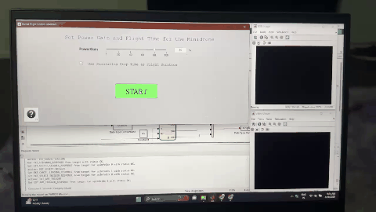
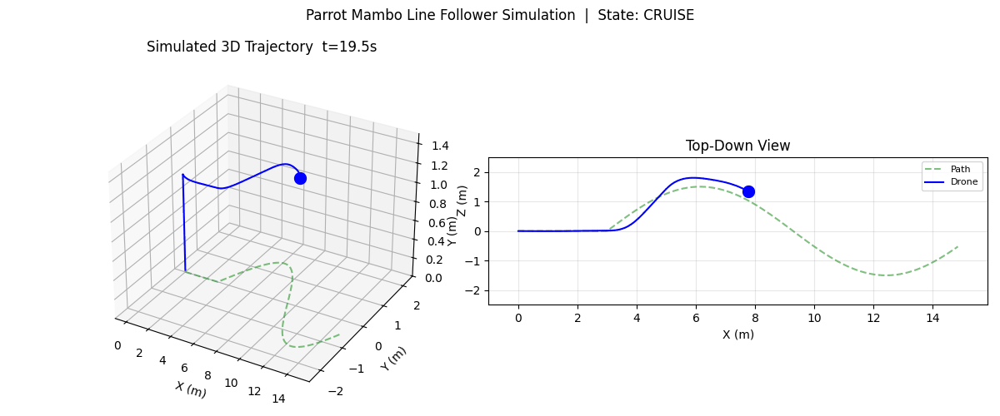

# Parrot Mambo Autonomous Line Following & Landing

**Author**: Rhutvik

| Real Hardware Flight | Python Simulation |
|---------------------|-------------------|
| [](output/line_follower.mp4) | [](output/simulation_s_curve.mp4) |
| *Click for full video (22 MB, 60s)* | *Click for full video (generated with \`--record\`)* |

Pure-Python simulation replica of the MATLAB/Simulink + Stateflow project for autonomous line following and landing on a Parrot Mambo minidrone. Runs entirely in software — no hardware required.

Pure-Python simulation replica of the MATLAB/Simulink + Stateflow project for autonomous line following and landing on a Parrot Mambo minidrone. Runs entirely in software — no hardware required.

## Overview

| Aspect | Details |
|--------|---------|
| **Domain** | UAV / Drone Control |
| **Original Stack** | MATLAB Simulink, Stateflow, Simulink Support Package for Parrot Minidrones |
| **This Replica** | Python 3.10+, NumPy, SciPy, OpenCV, Matplotlib |
| **Simulation** | Pure Python physics + simulated camera + Stateflow logic |

## Architecture

```
Camera Feed (Y1UY2V) → RGB Conversion → HSV Color Thresholding 
      → 3-Region Analysis (Left/Center/Right) → Steering Signal

State Machine (Chart 1):
  HOVER (2s) → CRUISE (continuous yaw) → LAND (10 frames line loss) → LANDED

Steering Logic (Chart 2):
  Left Region  → Path on Right → Turn Right (negative yaw)
  Center       → Straight
  Right Region → Path on Left  → Turn Left (positive yaw)
  None         → Land Trigger
```

## Quick Start

```bash
# Install dependencies
pip install -r requirements.txt

# Run with live animation (requires display)
python src/main.py

# Run headless (CI/server) - generates plots + CSV logs
python src/main.py --headless

# Record simulation video (requires ffmpeg)
python src/main.py --record

# Try different paths
python src/main.py --path figure8 --record
```

## Outputs

```
output/
├── trajectory_summary.png     # 2×2: trajectory, altitude, CTE, velocities
├── state_timeline.png         # State machine timeline (HOVER→CRUISE→LAND)
├── simulation_<path>.mp4      # Full 6-panel animation (with --record)
logs/
├── flight_log_<path>.csv      # Position, velocity, yaw, state, steering, CTE
```

## Sample Results (s_curve path)

| Metric | Value |
|--------|-------|
| Total time | 40.0 s |
| Distance traveled | 17.17 m |
| Path length | 16.29 m |
| Mean cross-track error | 0.192 m |
| Max cross-track error | 0.331 m |
| RMS cross-track error | 0.227 m |
| Landing accuracy | 0.331 m from target |
| State durations | HOVER: 2.0s, CRUISE: 34.5s, LAND: 3.5s |

## Real Hardware Demo

The `output/line_follower.mp4` in this repo is the **actual flight test** of the Parrot Mambo running the original Simulink/Stateflow controller:

- **Takeoff** → autonomous climb to hover height
- **Line following** → tracks red/orange tape through S-curves
- **Precision landing** → detects landing circle, centers, descends

| | |
|---|---|
| **Video** | [`output/line_follower.mp4`](output/line_follower.mp4) (22 MB, 60s, 1080p) |
| **Preview** |  |
| **Controller** | Original MATLAB/Simulink + Stateflow |

> **Note**: GitHub doesn't play large MP4 videos inline. The GIF above loops automatically — click it or the link above to download the full video.

## Side-by-Side: Simulation vs Real Hardware

### Generate comparison videos

```bash
# Side-by-side (simulated left, real right)
ffmpeg -i output/simulation_s_curve.mp4 -i output/line_follower.mp4 \
  -filter_complex "[0:v][1:v]hstack=inputs=2[v]" -map "[v]" \
  output/side_by_side.mp4

# Picture-in-picture (sim main, real in corner)
ffmpeg -i output/simulation_s_curve.mp4 -i output/line_follower.mp4 \
  -filter_complex "[1:v]scale=320:240[pip];[0:v][pip]overlay=W-w-10:H-h-10[v]" -map "[v]" \
  output/pip_comparison.mp4

# With labels
ffmpeg -i output/simulation_s_curve.mp4 -vf "drawtext=text='SIMULATED':x=10:y=30:fontsize=24:fontcolor=white:box=1:boxcolor=black@0.5" output/sim_labeled.mp4
ffmpeg -i output/line_follower.mp4 -vf "drawtext=text='REAL HARDWARE':x=10:y=30:fontsize=24:fontcolor=white:box=1:boxcolor=black@0.5" output/real_labeled.mp4
```

## Configuration

Edit `src/config.py` to tune:

```python
# Drone physics
drone.max_velocity = 1.5      # m/s
drone.hover_height = 1.0      # m
drone.landing_speed = 0.3     # m/s descent

# Camera
camera.fov_horizontal = 90.0  # degrees (wider for curves)

# State machine
state_machine.hover_duration = 2.0    # seconds
state_machine.cruise_velocity = 0.5   # m/s
state_machine.land_trigger_lost_frames = 10

# Steering
steering.yaw_gain = 1.5       # Proportional gain
steering.max_yaw_command = 1.0 # Normalized [-1, 1]
```

## Available Test Paths

| Path | Description |
|------|-------------|
| `s_curve` | Gentle S-curve with straight lead-in (default) |
| `figure8` | Figure-8 pattern |
| `sharp_turns` | 90° turns |
| `spiral` | Inward spiral |
| `straight` | Straight line |

```bash
python src/main.py --path figure8 --record
```

## Requirements

- Python 3.10+
- NumPy ≥ 1.24
- SciPy ≥ 1.10
- Matplotlib ≥ 3.7
- OpenCV ≥ 4.8
- ffmpeg (for video recording)

```bash
pip install -r requirements.txt
# Ubuntu: sudo apt install ffmpeg
# macOS: brew install ffmpeg
```

## Project Structure

```
parrot-mambo-line-follower/
├── README.md
├── requirements.txt
├── .gitignore
├── src/
│   ├── config.py            # All parameters (dataclasses)
│   ├── drone_sim.py         # 3D drone dynamics (first-order response)
│   ├── image_processing.py  # Camera + HSV thresholding + 3-region analysis
│   ├── state_machine.py     # Chart 1: HOVER/CRUISE/LAND FSM
│   ├── steering.py          # Chart 2: proportional yaw control
│   ├── path_generator.py    # Test path generation
│   ├── visualize.py         # 6-panel animation + static plots
│   └── main.py              # CLI entry point
├── output/
│   ├── line_follower.mp4    # Real hardware video (your flight)
│   ├── trajectory_summary.png
│   ├── state_timeline.png
│   └── simulation_*.mp4     # Generated with --record
└── logs/
    └── flight_log_*.csv     # Full flight data
```

## License

MIT — Educational use. Original project referenced for academic purposes.